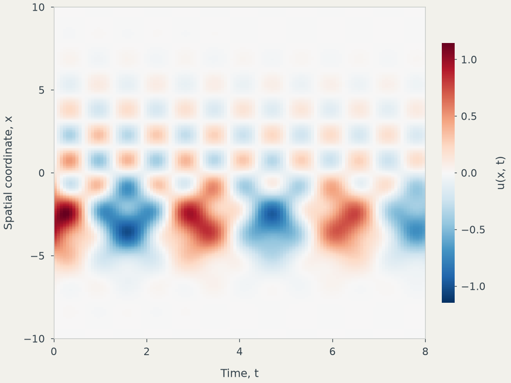

# Koopman / SciML

**A research workspace for learning data-driven dynamics, from synthetic signals to simulated spacecraft rotation.**

The aim is to build understandable, reproducible baselines for Koopman-based system identification. This repository starts with synthetic data generation; DMD, EDMD, and continuous-time generator identification are planned next steps.

**Status:** early development. The current script generates and plots data; despite its filename, it does **not yet implement exact DMD**. No identification or prediction results are reported here.

## What is here

| File | Purpose |
| --- | --- |
| [`01_exact_dmd_numpy.py`](01_exact_dmd_numpy.py) | Generate a synthetic field with two damped temporal components. |
| [`1.ipynb`](1.ipynb) | Initial scratch notebook; not a completed experiment. |
| [`docs/index.html`](docs/index.html) | Standalone English project page. |
| [`scripts/export_preview.py`](scripts/export_preview.py) | Rebuild the project-page figure from the existing data script. |

The starter produces a **200 × 120** array: spatial points along rows and time snapshots along columns. It combines two fixed spatial patterns with damped sinusoidal coefficients. This is a synthetic signal, not a fluid simulation or spacecraft dataset.

## Quick start

Use Python 3.11 or newer. From the repository directory:

```sh
python -m venv .venv
```

Activate the environment in your shell:

```powershell
# Windows PowerShell
.\.venv\Scripts\Activate.ps1
```

```sh
# macOS / Linux
source .venv/bin/activate
```

Then install the dependencies and run the starter:

```sh
python -m pip install -r requirements.txt
python 01_exact_dmd_numpy.py
```

The script opens a plot of the generated field. It does not fit a model or save results. On a machine without a graphical display, use the preview exporter instead:

```sh
python scripts/export_preview.py
```



## Research roadmap

1. **Current — synthetic-data starter.** Generate a small, inspectable dataset and understand the snapshot layout.
2. **Next — DMD baseline.** Form paired snapshot matrices, fit a reduced operator, and evaluate reconstruction and held-out prediction. Check rank and observability before interpreting eigenvalues: two spatial patterns do not by themselves expose all oscillatory dynamics.
3. **Planned — nonlinear identification.** Add a Van der Pol benchmark, EDMD dictionaries, and continuous-time generator identification. Study sampling, noise, scaling, conditioning, and regularization.
4. **Planned — spacecraft rotation.** Apply the baselines to simulated torque-free asymmetric rigid-body dynamics. Evaluate vector-field error, unseen-initial-condition prediction, invariant drift, and failure cases.

These are intended experiments, not completed results. The spacecraft scope is simulation-based; no hardware, in-orbit validation, or control performance is claimed.

## Project page

Open `docs/index.html` directly in a browser; the page needs no build step or external services. To preview it over HTTP:

```sh
python -m http.server 8000 --directory docs
```

Then open `http://localhost:8000`. To publish later, create a GitHub repository, push these files, and configure GitHub Pages to serve the `docs` directory on your chosen branch.
